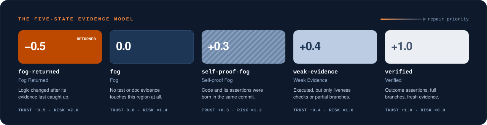

<p align="center">
  <a href="https://github.com/3arry2hu/codefog">
    <picture>
      <source media="(prefers-color-scheme: dark)" srcset="./docs/assets/readme/hero-dark.svg">
      <source media="(prefers-color-scheme: light)" srcset="./docs/assets/readme/hero-light.svg">
      
    </picture>
  </a>
</p>

<p align="center">
  <a href="https://www.npmjs.com/package/@barryzhu/codefog"></a>
  <a href="./LICENSE"></a>
  = 16" src="https://img.shields.io/badge/node-%E2%89%A5%2016-BCCCE2?style=flat-square&labelColor=0E1A2B&logo=nodedotjs&logoColor=white">
  
  
</p>

<p align="center">
  <a href="#quick-start"><b>Quick start</b></a> &nbsp;·&nbsp;
  <a href="#the-five-state-model">Five states</a> &nbsp;·&nbsp;
  <a href="#doc-claims-fighting-doc-rot">Doc claims</a> &nbsp;·&nbsp;
  <a href="#ai-agent-skill">AI agent skill</a> &nbsp;·&nbsp;
  <a href="#cli-reference">CLI</a> &nbsp;·&nbsp;
  <a href="#scoring">Scoring</a> &nbsp;·&nbsp;
  <a href="#programmatic-api">API</a>
  <br><br>
  <b>English</b> &nbsp;|&nbsp; <a href="./README_zh.md">简体中文</a>
</p>

---

**Coverage tells you which lines ran. codefog tells you which lines are actually proven, and which docs still tell the truth.**

codefog is a fog-first trust and risk map for **TypeScript / JavaScript, Go, Rust, Java** and polyglot monorepos. It combines coverage, assertion analysis, Git history, mutation results and the claims your Markdown makes about the code, then sorts every line and every doc claim into one of five evidence states. The result is a trust score you can gate CI on, an offline interactive Fog Map, and a list of machine-readable Findings that an AI coding agent can fix and verify on its own.

## Why codefog

Green coverage hides three kinds of rot:

<table>
  <tr>
    <td width="33%" valign="top">
      <h3>Pseudo-coverage</h3>
      A test that calls a function and only checks <code>toBeDefined()</code> makes the line green without proving anything. codefog tells <b>outcome assertions</b> apart from <b>liveness checks</b> using the syntax tree, then confirms the difference with mutants.
    </td>
    <td width="33%" valign="top">
      <h3>Fog that returns</h3>
      Code that was well tested last quarter, then had its logic rewritten while the tests stayed put. codefog compares <b>runtime fingerprints</b> in Git history, ignoring comment and type-only edits, and flags the region <code>fog-returned</code>.
    </td>
    <td width="33%" valign="top">
      <h3>Doc rot</h3>
      READMEs, ADRs and <code>AGENTS.md</code> files that name functions, paths and commands that were renamed, changed or deleted. codefog checks every <b>Doc Claim</b> against the code and its history, and can run the examples.
    </td>
  </tr>
</table>

## How it works

<p align="center">
  
</p>

- **Zero install friction.** Language support is built in through pure-TypeScript adapters ([ADR-0003](./docs/adr/0003-polyglot-language-adapter-architecture.md)). There is no wasm, no native binary and no per-language plugin to install.
- **Fog-first visuals.** Verified code fades into the background, so your eye goes straight to what is unproven ([ADR-0001](./docs/adr/0001-fog-first-visual-and-five-state-model.md)).
- **Built for agents.** Every Finding comes with a stable `CF-xxxx` ID, a root cause and a `codefog verify` command that refuses gamed fixes.

## Quick start

Run it at the root of any Git repository. No global install is needed:

```bash
npx @barryzhu/codefog
```

This auto-detects coverage and mutation reports, prints a summary, and writes the interactive Fog Map to `.codefog/report.html`. Add `--docs` to check your Markdown as well:

```bash
npx @barryzhu/codefog --docs --open
```

> [!NOTE]
> Use **npm / npx 9 or newer**. Older versions (for example 8.15) swallow flags like `--coverage` unless you add a `--` separator. codefog detects old npm, prints an upgrade hint and recovers the stripped flags.

Or install it as a dev dependency:

```bash
npm install -D @barryzhu/codefog
```

### Language recipes

<details>
<summary><b>TypeScript / JavaScript</b>: Vitest or Jest, plus Stryker</summary>

```bash
vitest run --coverage.enabled=true --coverage.reporter=lcov
npx @barryzhu/codefog --coverage coverage/lcov.info --mutation-report reports/mutation/mutation.json
```
</details>

<details>
<summary><b>Go</b>: <code>go test -coverprofile</code></summary>

```bash
go test -coverprofile=coverage.out ./...
npx @barryzhu/codefog --coverage coverage.out
```
</details>

<details>
<summary><b>Rust</b>: cargo-llvm-cov, plus cargo-mutants</summary>

```bash
cargo llvm-cov --lcov --output-path coverage/lcov.info
npx @barryzhu/codefog --coverage coverage/lcov.info --mutation-report mutants.out/outcomes.json
```
</details>

<details>
<summary><b>Java</b>: Maven or Gradle with JaCoCo, plus PITest</summary>

```bash
mvn test jacoco:report
npx @barryzhu/codefog --coverage target/site/jacoco/jacoco.xml --mutation-report target/pit-reports/mutations.xml
```
</details>

<details>
<summary><b>Polyglot monorepo</b>: merge several coverage reports</summary>

`--coverage` is repeatable and accepts comma-separated paths. All reports merge into one repository-level report:

```bash
npx @barryzhu/codefog \
  --coverage coverage/lcov.info \
  --coverage services/billing/coverage.out \
  --coverage crates/engine/lcov.info \
  --coverage java-core/target/site/jacoco/jacoco.xml
```
</details>

### What you get

```text
codefog | payment-service (main @ 64c2ba2)
Trust Score: 74/100 | Doc Trust Score: 81/100 | Files: 12 | LOC: 840 | Unverified (Fog): 26%
Metrics: Line 88.5% | Branch 79.2% | Checked 71.4% | Mutation 82.0% | Pseudo-tested: 1 | Contested: 0
States: Returned=18 Fog=92 Self-proof=34 Weak=74 Verified=622
Doc Claims (64): Returned=3 Fog=9 Weak=21 Verified=31

Modules by Fog:
  - internal/settlement: Trust 58/100 | Risk 7.8 | Fog=42 Weak=30 Verified=110
  - src/core: Trust 86/100 | Risk 4.1 | Fog=12 Weak=18 Verified=320
  - docs: Trust 81/100 | Risk 3.2 | Fog=9 Weak=21 Verified=31

Top Fog Hotspots & Findings:
  - [CF-8A2F] internal/settlement/ledger.go:42-89 (ReconcileBatch) | fog-returned | risk 7.8
  - [CF-3C19] src/core/discount.ts:15-48 (calculateTierDiscount) | weak-evidence | risk 5.4
```

## The five-state model

Classic coverage only knows "ran" and "didn't run". codefog assigns every executable line, and every doc claim, one of five evidence states:

<p align="center">
  
</p>

<details>
<summary><b>Exact rules for each state</b></summary>

| State | Rule for code | Trust weight | Risk weight |
| :--- | :--- | :---: | :---: |
| `fog-returned` | Was covered, but its latest **runtime-logic** change is newer than the related tests. Comment, doc and type-only edits do not count. | `-0.5` | `2.0` |
| `fog` | No test executes or covers the region. | `0.0` | `1.4` |
| `self-proof-fog` | Production code and its outcome assertions were born in the same commit, with no independent expectation yet. Killing every mutant does not lift this on its own ([ADR-0004](./docs/adr/0004-mutation-kill-does-not-clear-self-proof.md)). | `+0.3` | `1.2` |
| `weak-evidence` | Executed, but only by liveness checks, with branch coverage below 100%, or with surviving mutants. | `+0.4` | `1.0` |
| `verified` | Outcome assertions, full branch coverage, no surviving mutants, and evidence that is fresh against the latest change. | `+1.0` | `0.0` |

Full definitions live in [`GLOSSARY.md`](./GLOSSARY.md).
</details>

### Language support

| | TypeScript / JavaScript | Go | Rust | Java |
| :--- | :--- | :--- | :--- | :--- |
| **Sources** | `.ts` `.tsx` `.js` `.jsx` | `.go`, excluding `*_test.go` | `.rs`, with inline `#[cfg(test)]` modules stripped | `.java` under `src/main/java` |
| **Coverage** | LCOV | `coverprofile`, normalized with `go.mod` | LCOV from `cargo llvm-cov` | JaCoCo XML or LCOV |
| **Outcome assertions** | `expect(x).toBe(y)`, `toEqual`, `toThrow` | `t.Errorf` value checks, `reflect.DeepEqual`, `cmp.Diff`, `assert.Equal` | `assert_eq!`, `assert_ne!`, `matches!`, `#[should_panic(expected)]` | JUnit 5 `assertEquals`, `assertThrows`, AssertJ `isEqualTo` |
| **Liveness checks** | `toBeDefined()`, `toBeTruthy()`, `not.toThrow()` | `err == nil`, `require.NoError` | `.unwrap()`, `assert!(r.is_ok())` | `assertNotNull`, `isPresent()` |
| **Freshness noise filter** | Comments, `type` and `interface` edits | GoDoc, comments, imports | Comments and doc comments; same-file tests tracked separately | Javadoc, comments, annotations |
| **Mutation reports** | Stryker JSON | built-in `codefog verify` | `cargo-mutants` JSON | PITest XML |
| **`codefog verify` runner** | `npx vitest run` | `go test ./...` | `cargo test` | `mvn test` / `./gradlew test` |

## Doc claims: fighting doc rot

With `--docs`, codefog reads your Markdown and AI instruction files the way it reads code. Every backticked symbol, path and command, and every local link, becomes a **Doc Claim**. Each claim is resolved to its **Referent** in the code and given one of the same five states. The results add up to a separate **Doc Trust Score**, so code and docs never mask each other ([ADR-0005](./docs/adr/0005-doc-claims-reuse-five-state-model.md)).

```bash
npx @barryzhu/codefog --docs --fail-on doc-returned
```

**What gets scanned.** `*.md` at the root and under `docs/`, ADRs, `AGENTS.md`, `CLAUDE.md`, `.cursor/rules/*`, `.github/copilot-instructions.md` and `skills/**/SKILL.md`.

| Claim | Example | Checked against |
| :--- | :--- | :--- |
| Symbol | `` `calculateFee` `` | Functions, classes and methods in all four languages; runtime fingerprint history |
| Path | `` `docs/guide.md` `` | The working tree. Generated output such as `.codefog/`, `dist/` or gitignored files counts as `fog`, never as rot |
| Command | `` `npm run build` `` | `package.json` scripts, `node` / `tsx` targets, this repo's CLI subcommands |
| Link and anchor | `[guide](docs/guide.md#setup)` | Local files and headings. External URLs are checked only with `--check-external-links` |
| Code block | a fenced `ts`, `go`, `rust` or `java` block | Executed with `--run-docs`; outcome assertions decide `verified` vs `weak-evidence` |

**Doc fog returned.** When a referent changes after the paragraph, list item, table row or code block that describes it, the claim becomes `fog-returned`, the same state used for stale tests. A claim leaves that state only when its block gets a real (non-whitespace) edit that still resolves. Editing the code and the doc in the same commit counts as in sync.

> [!IMPORTANT]
> `--run-docs` executes only `ts`, `js`, `go`, `rust` and `java` code blocks. Shell blocks (`bash`, `sh`, `console`, `powershell` and similar) are **never** executed. Self-imports of your own package resolve to the local entry point. Nothing else is injected, so an example passes only if a reader could actually run it.

**Instruction conflicts.** When `AGENTS.md` says `npm test` and `CLAUDE.md` says `npx vitest run` for the same intent (install, build, test or lint), codefog reports an `instruction-conflict` Finding that points at both lines.

**Opting out.** Put `<!-- codefog-ignore-next -->` before a block, or `<!-- codefog-ignore-file -->` anywhere in a file. Ignored claims are not scored.

**External tools.** codefog does not reinvent linters, dead-code finders or dependency checkers. It imports their results as an overlay:

```bash
npx @barryzhu/codefog --sarif semgrep.sarif --knip knip.json --libyear libyear.json
```

SARIF 2.1.0 (from Qlty, SonarQube, Semgrep and others) and Knip issues land on the matching code regions. They raise Risk Score but never change evidence states or trust scores. libyear shows up as a repository-level dependency drift summary.

## AI agent skill

codefog ships a ready-made skill that teaches coding agents to evaluate a repo, fix the riskiest Findings, and prove each fix before moving on. One command installs it for **Codex, Claude Code, CodeBuddy and Cursor**:

```bash
# All four agents, project scope
npx @barryzhu/codefog@latest install-skill

# Selected agents only
npx @barryzhu/codefog@latest install-skill --agent cursor,claude-code

# User scope (~/.codex, ~/.claude, ~/.codebuddy, ~/.cursor)
npx @barryzhu/codefog@latest install-skill --global
```

<details>
<summary><b>Install locations</b></summary>

| `--agent` | Project scope | `--global` |
| :--- | :--- | :--- |
| `codex` | `.codex/skills/codefog/SKILL.md` and `.agents/skills/codefog/SKILL.md` | `~/.codex/skills/codefog/SKILL.md` and `~/.agents/skills/codefog/SKILL.md` |
| `claude-code` | `.claude/skills/codefog/SKILL.md` | `~/.claude/skills/codefog/SKILL.md` |
| `codebuddy` | `.codebuddy/skills/codefog/SKILL.md` | `~/.codebuddy/skills/codefog/SKILL.md` |
| `cursor` | `.cursor/skills/codefog/SKILL.md` | `~/.cursor/skills/codefog/SKILL.md` |
</details>

Then ask your agent something like *"Use codefog to evaluate this project and keep improving the tests until the trust target is met."* The skill runs a closed loop:

1. **Baseline.** Detect the languages, generate coverage, run codefog.
2. **Conclusion.** Report the Trust Score, the five-state distribution, the top `CF-xxxx` Findings with root causes, and a target.
3. **Iterate.** Work in risk order (`fog-returned`, `fog`, `weak-evidence`, `self-proof-fog`). After each file, run `codefog verify <file> --mutants`, which rejects deleted branches and assertion-free tests.
4. **Doc sync.** Edit only docs, and pass `codefog verify <doc.md>` for every changed doc.
5. **Report.** Show before and after for Trust Score, Doc Trust Score, checked coverage and mutation score.

The full guide with prompt templates is in [`docs/ai-skill-guide.md`](./docs/ai-skill-guide.md) (Chinese).

## CLI reference

### `codefog [rootDir] [options]`

| Option | Description | Default |
| :--- | :--- | :--- |
| `--coverage <path>` | Coverage file(s): LCOV, Go `coverprofile`, JaCoCo XML. Repeatable or comma-separated. Alias: `--lcov` | auto-detected |
| `--mutation-report <path>` | Stryker JSON, PITest XML or `cargo-mutants` JSON. Alias: `--stryker` | auto-detected |
| `--expectations <path>` | Independent expectation manifest | `oracles/expectations.json` if present |
| `--defects <path>` | Historical defect manifest | `oracles/defects.json` if present |
| `--docs` | Scan Markdown and AI instruction files for Doc Claims | off |
| `--check-external-links` | Also check external HTTP(S) links (needs `--docs`) | off |
| `--run-docs` | Execute runnable code blocks (needs `--docs`) | off |
| `--sarif <path>` | Import SARIF 2.1.0 results as an overlay. Repeatable | — |
| `--knip <path>` | Import a Knip JSON report as an overlay. Repeatable | — |
| `--libyear <path>` | Import a libyear JSON report. Repeatable | — |
| `--diff <baseRef>` | Compare against a base ref such as `origin/main` | — |
| `--pr-comment [dir]` | Write `pr-comment.md` and `pr-diff.svg` | `.codefog` |
| `--html <path>` | Fog Map output path | `.codefog/report.html` |
| `--open` | Open the Fog Map in your browser | off |
| `--json` | Print the full JSON report to stdout | off |
| `--fail-on <policy>` | CI exit gate, see below | `returned` |
| `-v`, `--version` / `-h`, `--help` | Version and help | — |

<details>
<summary><b><code>--fail-on</code> policies</b></summary>

| Policy | Exits with `1` when |
| :--- | :--- |
| `returned` (default) | Any code is `fog-returned` |
| `doc-returned` | Any doc claim is `fog-returned`. Instruction conflicts do not trip it |
| `regression` | Code is `fog-returned`, a file lost evidence under `--diff`, or coverage went up while real evidence went down |
| `any-fog` | Any line is not `verified` |
| `contested` | An outcome assertion contradicts an independent expectation or a historical defect |
| `none` | Never; only report |
</details>

### `codefog verify <file> [options]`

A per-file **anti-gaming gate** for humans and agents. Run it after fixing a Finding to prove the fix is real.

```bash
npx @barryzhu/codefog verify src/pricing.ts --lines 10-45 --mutants
npx @barryzhu/codefog verify internal/tax/calc.go --mutants --test-cmd "go test ./..."
npx @barryzhu/codefog verify README.md
```

| Option | Description |
| :--- | :--- |
| `--lines <start-end>` | Limit checks to a line range |
| `--mutants` | Run synthetic mutants: operator flips and body clearance |
| `--oracle` | Reject assertions that contradict expectations or known defects |
| `--test-cmd <cmd>` | Custom test command. Defaults to `vitest`, `go test`, `cargo test` or `mvn test` by extension |
| `--run-docs` | For `.md` targets, require changed code blocks to pass |
| `--allow-source-change` | Allow uncommitted edits to the production file (or, for docs, to referenced code) |

<details>
<summary><b>What <code>verify</code> rejects</b></summary>

**For source files**
1. **Production edits.** Removing branches from the code under test to make the numbers go up.
2. **Hollow baselines.** The suite must pass before mutation and contain real assertions.
3. **Pseudo-tested methods.** If replacing a function body with a zero value still passes, the test proves nothing.
4. **Surviving operator mutants.** Arithmetic, comparison and boolean flips must be caught. Mutants that do not compile in typed languages are excluded from the score.
5. **Contested assertions** (`--oracle`). Assertions must not be rewritten to match the current wrong output.

**For Markdown files**
1. **Vague rewrites.** Deleting a `fog-returned` claim whose referent still exists is rejected. Rename it to the new symbol instead. Deleting claims about removed referents is fine.
2. **Fixing docs by changing code.** Referenced source files must have no uncommitted changes unless `--allow-source-change` is set.
3. **Broken claims.** Every claim in a changed block must resolve, and with `--run-docs` every changed code block must pass.
</details>

## Fog Map and PR reports

**`.codefog/report.html`** is a single self-contained file with no CDN dependencies. Open it offline or archive it as a CI artifact. It has four levels of progressive disclosure:

| Level | Shows |
| :--- | :--- |
| **1 · Repository** | Trust Score and Doc Trust Score, the five-state bar, key metrics, top 5 Findings, libyear drift |
| **2 · Modules** | State counts per module, including a `docs` group. Fully verified files fold away |
| **3 · Treemap** | Area by LOC (or claim count for docs), color and texture by state |
| **4 · Source** | Line-by-line states, surviving mutants, external tool issues, doc referents with their last-change commit, and copy-ready agent prompts |

**PR reports** compare a branch against its base and produce a comment you can post as-is:

```bash
npx @barryzhu/codefog --diff origin/main --pr-comment .codefog --fail-on regression
```

`pr-comment.md` shows trust before and after, newly `fog-returned` files, **"Coverage up, evidence down"** warnings, and with `--docs` a doc section listing new doc rot and deleted claims. `pr-diff.svg` is a before/after state chart. See [`.github/workflows/codefog.yml`](./.github/workflows/codefog.yml) for a working CI setup.

## Scoring

**Trust Score** (0 to 100) measures evidence health for a repo, module or file. The Doc Trust Score uses the same weights, counted per claim instead of per line.

```math
\text{Trust} = \operatorname{clamp}_{[0,100]}\left(\operatorname{round}\left(\frac{1.0\,L_{\text{verified}} + 0.4\,L_{\text{weak}} + 0.3\,L_{\text{self-proof}} - 0.5\,L_{\text{returned}}}{L_{\text{total}}} \times 100\right)\right)
```

**Risk Score** (0.0 to 10.0) ranks how urgently a file or Finding needs work, from unverified lines, 90-day churn, cyclomatic complexity and the state weight:

```math
R_{\text{raw}} = \ln(1 + \max(1, L_{\text{unverified}})) \cdot \ln(1 + \max(1, \text{Churn}_{90d})) \cdot \ln(1 + \max(1, \text{CC})) \cdot W_{\text{state}} \cdot \left(1 + \ln(1 + n_{\text{external}})\right)
```

```math
\text{Risk} = \operatorname{round}_{0.1}\left(\min\left(10,\ \max\left(0.1,\ \frac{R_{\text{raw}}}{R_{\text{raw}} + 3.5} \times 10\right)\right)\right)
```

The last factor of $R_{\text{raw}}$ applies only when external reports are imported; $n_{\text{external}}$ is the number of imported issues inside the region.

- **Checked coverage**: executable lines that are covered, tied to at least one outcome assertion, and not `fog-returned`.
- **Pseudo-tested methods**: methods that are executed but have no outcome assertion, or whose tests still pass when the body is cleared.

## Programmatic API

`@barryzhu/codefog` is an ESM package with full TypeScript types:

```typescript
import { analyzeRepository, verifyTargetWithMutants, writeHtmlFogMap } from "@barryzhu/codefog";

const report = await analyzeRepository({
  rootDir: process.cwd(),
  coveragePath: ["coverage/lcov.info", "coverage.out"],
  mutationReportPath: "mutants.out/outcomes.json",
  diffBase: "origin/main",
  docs: true,
});

console.log(`Trust ${report.summary.trustScore}/100, Doc Trust ${report.summary.docTrustScore}/100`);

await writeHtmlFogMap(process.cwd(), report, ".codefog/report.html");

const result = await verifyTargetWithMutants({
  rootDir: process.cwd(),
  targetFile: "src/analyzer.ts",
  mutants: true,
});
console.log(result.passed, result.summary);
```

## Development

Requires **Node.js 20+** for development (the CLI itself runs on Node.js 16+).

```bash
npm install
npm test            # end-to-end suites for TS/JS, Go, Rust, Java and docs
npm run typecheck
npm run build
npm run dogfood     # run codefog on itself
```

The Go, Rust and Java doc-execution suites skip automatically when that toolchain is not installed.

**Further reading:** [`GLOSSARY.md`](./GLOSSARY.md) for domain terms, [`docs/adr/`](./docs/adr/) for architecture decisions, and [`docs/research/code-and-doc-rot.md`](./docs/research/code-and-doc-rot.md) for the research on code and doc rot behind the roadmap.

## License

[MIT](./LICENSE)

<p align="center"><sub>Built for people, and the agents working with them, who need to know what is actually proven.</sub></p>
