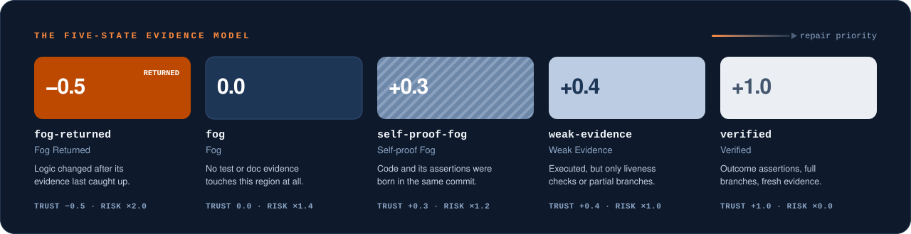

<p align="center">
  <a href="https://github.com/3arry2hu/codefog">
    <picture>
      <source media="(prefers-color-scheme: dark)" srcset="./docs/assets/readme/hero-dark.svg">
      <source media="(prefers-color-scheme: light)" srcset="./docs/assets/readme/hero-light.svg">
      
    </picture>
  </a>
</p>

<p align="center">
  <a href="https://www.npmjs.com/package/@barryzhu/codefog"></a>
  <a href="./LICENSE"></a>
  
  
  
</p>

<p align="center">
  <a href="#快速开始"><b>快速开始</b></a> &nbsp;·&nbsp;
  <a href="#五态证据模型">五态模型</a> &nbsp;·&nbsp;
  <a href="#文档声明">文档声明</a> &nbsp;·&nbsp;
  <a href="#ai-agent-skill">AI Agent Skill</a> &nbsp;·&nbsp;
  <a href="#cli-参考">CLI</a> &nbsp;·&nbsp;
  <a href="#评分公式">评分</a> &nbsp;·&nbsp;
  <a href="#编程接口">API</a>
  <br><br>
  <a href="./README.md">English</a> &nbsp;|&nbsp; <b>简体中文</b>
</p>

---

**覆盖率只告诉你哪些行被执行过。codefog 告诉你哪些行真正被证明过，以及哪些文档还在说真话。**

codefog 是一款“雾优先”的代码信任与风险地图，支持 **TypeScript / JavaScript、Go、Rust、Java** 以及多语言混合仓库。它综合覆盖率、断言分析、Git 历史、变异测试结果，以及 Markdown 文档对代码作出的声明，把每一行代码和每一条文档声明归入五种证据状态之一。最终你会得到：可以作为 CI 门禁的信任分、可离线打开的交互式雾图，以及一组机器可读的发现项（Finding），AI 编码代理可以据此自行修复并验收。

## 为什么需要 codefog

绿色的覆盖率背后藏着三种腐化：

<table>
  <tr>
    <td width="33%" valign="top">
      <h3>伪覆盖</h3>
      测试调用了函数却只检查 <code>toBeDefined()</code>，这行代码变绿了，但什么也没证明。codefog 通过语法树区分<b>结果断言</b>与<b>存活性检查</b>，再用变异体确认两者的差别。
    </td>
    <td width="33%" valign="top">
      <h3>回雾</h3>
      上个季度测试很充分的代码，后来逻辑被重写，测试却原地不动。codefog 比对 Git 历史中的<b>运行时指纹</b>（忽略注释和纯类型改动），把这类区域标记为 <code>fog-returned</code>。
    </td>
    <td width="33%" valign="top">
      <h3>文档腐化</h3>
      README、ADR 和 <code>AGENTS.md</code> 里提到的函数、路径和命令，早已改名、改动或删除。codefog 把每一条<b>文档声明</b>与代码及其历史逐一核对，还能直接运行文档里的示例。
    </td>
  </tr>
</table>

## 工作原理

<p align="center">
  
</p>

- **零安装负担。** 多语言支持由纯 TypeScript 适配器实现（[ADR-0003](./docs/adr/0003-polyglot-language-adapter-architecture.md)），无需 wasm、原生二进制或各语言插件。
- **雾优先视觉。** 已验证的代码退到背景里，视线会直接落在尚未被证明的区域（[ADR-0001](./docs/adr/0001-fog-first-visual-and-five-state-model.md)）。
- **为 Agent 而生。** 每个发现项都有稳定的 `CF-xxxx` ID、根因说明，以及一条会拒绝作弊式修复的 `codefog verify` 命令。

## 快速开始

在任意 Git 仓库根目录运行，无需全局安装：

```bash
npx @barryzhu/codefog
```

它会自动探测覆盖率与变异测试报告，在终端打印摘要，并把交互式雾图写入 `.codefog/report.html`。加上 `--docs` 可以同时检查文档：

```bash
npx @barryzhu/codefog --docs --open
```

> [!NOTE]
> 请使用 **npm / npx 9 及以上版本**。旧版本（例如 8.15）在不加 `--` 分隔符时会吞掉 `--coverage` 等参数。codefog 检测到旧版 npm 时会打印升级提示，并恢复被剥离的参数。

也可以作为开发依赖安装：

```bash
npm install -D @barryzhu/codefog
```

### 各语言用法

<details>
<summary><b>TypeScript / JavaScript</b>：Vitest 或 Jest，加 Stryker</summary>

```bash
vitest run --coverage.enabled=true --coverage.reporter=lcov
npx @barryzhu/codefog --coverage coverage/lcov.info --mutation-report reports/mutation/mutation.json
```
</details>

<details>
<summary><b>Go</b>：<code>go test -coverprofile</code></summary>

```bash
go test -coverprofile=coverage.out ./...
npx @barryzhu/codefog --coverage coverage.out
```
</details>

<details>
<summary><b>Rust</b>：cargo-llvm-cov，加 cargo-mutants</summary>

```bash
cargo llvm-cov --lcov --output-path coverage/lcov.info
npx @barryzhu/codefog --coverage coverage/lcov.info --mutation-report mutants.out/outcomes.json
```
</details>

<details>
<summary><b>Java</b>：Maven 或 Gradle + JaCoCo，加 PITest</summary>

```bash
mvn test jacoco:report
npx @barryzhu/codefog --coverage target/site/jacoco/jacoco.xml --mutation-report target/pit-reports/mutations.xml
```
</details>

<details>
<summary><b>多语言混合仓库</b>：合并多份覆盖率报告</summary>

`--coverage` 可重复传入，也支持逗号分隔，所有报告会合并成一份仓库级报告：

```bash
npx @barryzhu/codefog \
  --coverage coverage/lcov.info \
  --coverage services/billing/coverage.out \
  --coverage crates/engine/lcov.info \
  --coverage java-core/target/site/jacoco/jacoco.xml
```
</details>

### 输出示例

```text
codefog | payment-service (main @ 64c2ba2)
Trust Score: 74/100 | Doc Trust Score: 81/100 | Files: 12 | LOC: 840 | Unverified (Fog): 26%
Metrics: Line 88.5% | Branch 79.2% | Checked 71.4% | Mutation 82.0% | Pseudo-tested: 1 | Contested: 0
States: Returned=18 Fog=92 Self-proof=34 Weak=74 Verified=622
Doc Claims (64): Returned=3 Fog=9 Weak=21 Verified=31

Modules by Fog:
  - internal/settlement: Trust 58/100 | Risk 7.8 | Fog=42 Weak=30 Verified=110
  - src/core: Trust 86/100 | Risk 4.1 | Fog=12 Weak=18 Verified=320
  - docs: Trust 81/100 | Risk 3.2 | Fog=9 Weak=21 Verified=31

Top Fog Hotspots & Findings:
  - [CF-8A2F] internal/settlement/ledger.go:42-89 (ReconcileBatch) | fog-returned | risk 7.8
  - [CF-3C19] src/core/discount.ts:15-48 (calculateTierDiscount) | weak-evidence | risk 5.4
```

## 五态证据模型

传统覆盖率只区分“执行过”和“没执行过”。codefog 为每一行可执行代码、每一条文档声明分配五种证据状态之一：

<p align="center">
  
</p>

<details>
<summary><b>各状态的判定规则</b></summary>

| 状态 | 代码判定规则 | Trust 权重 | Risk 权重 |
| :--- | :--- | :---: | :---: |
| `fog-returned`（回雾） | 曾被覆盖，但最近一次**运行时逻辑**改动晚于相关测试。注释、文档和纯类型改动不算。 | `-0.5` | `2.0` |
| `fog`（雾） | 没有任何测试执行或覆盖该区域。 | `0.0` | `1.4` |
| `self-proof-fog`（自证雾） | 生产代码与其结果断言诞生于同一次提交，且尚无独立预期确认。仅靠杀死全部变异体不能升级（[ADR-0004](./docs/adr/0004-mutation-kill-does-not-clear-self-proof.md)）。 | `+0.3` | `1.2` |
| `weak-evidence`（弱证据） | 已被执行，但只有存活性检查、分支覆盖不足 100%，或存在存活变异体。 | `+0.4` | `1.0` |
| `verified`（已验证） | 有结果断言、分支全覆盖、无存活变异体，且证据相对最新改动保持新鲜。 | `+1.0` | `0.0` |

完整术语定义见 [`GLOSSARY.md`](./GLOSSARY.md)。
</details>

### 多语言支持

| | TypeScript / JavaScript | Go | Rust | Java |
| :--- | :--- | :--- | :--- | :--- |
| **源码识别** | `.ts` `.tsx` `.js` `.jsx` | `.go`，排除 `*_test.go` | `.rs`，剥离同文件 `#[cfg(test)]` 模块 | `src/main/java` 下的 `.java` |
| **覆盖率** | LCOV | `coverprofile`，按 `go.mod` 归一化路径 | `cargo llvm-cov` 产出的 LCOV | JaCoCo XML 或 LCOV |
| **结果断言** | `expect(x).toBe(y)`、`toEqual`、`toThrow` | `t.Errorf` 值比较、`reflect.DeepEqual`、`cmp.Diff`、`assert.Equal` | `assert_eq!`、`assert_ne!`、`matches!`、`#[should_panic(expected)]` | JUnit 5 `assertEquals`、`assertThrows`，AssertJ `isEqualTo` |
| **存活性检查** | `toBeDefined()`、`toBeTruthy()`、`not.toThrow()` | `err == nil`、`require.NoError` | `.unwrap()`、`assert!(r.is_ok())` | `assertNotNull`、`isPresent()` |
| **新鲜度去噪** | 注释、`type` 与 `interface` 改动 | GoDoc、注释、import | 注释与文档注释；同文件测试单独追踪 | Javadoc、注释、注解 |
| **变异报告** | Stryker JSON | 内置 `codefog verify` | `cargo-mutants` JSON | PITest XML |
| **`codefog verify` 测试命令** | `npx vitest run` | `go test ./...` | `cargo test` | `mvn test` / `./gradlew test` |

## 文档声明

开启 `--docs` 后，codefog 会像分析代码一样分析 Markdown 和 AI 指令文件。每个反引号里的符号、路径和命令，以及每个本地链接，都是一条**文档声明（Doc Claim）**。每条声明会解析到代码中的**引用对象（Referent）**，并获得同样的五种状态之一。汇总结果是独立的**文档信任分（Doc Trust Score）**，代码与文档的分数互不掩盖（[ADR-0005](./docs/adr/0005-doc-claims-reuse-five-state-model.md)）。

```bash
npx @barryzhu/codefog --docs --fail-on doc-returned
```

**扫描范围。** 根目录与 `docs/` 下的 `*.md`、ADR、`AGENTS.md`、`CLAUDE.md`、`.cursor/rules/*`、`.github/copilot-instructions.md` 和 `skills/**/SKILL.md`。

| 声明类型 | 示例 | 核对依据 |
| :--- | :--- | :--- |
| 符号 | `` `calculateFee` `` | 四种语言中的函数、类和方法，以及运行时指纹历史 |
| 路径 | `` `docs/guide.md` `` | 工作区文件。`.codefog/`、`dist/` 或被 gitignore 的生成产物记为 `fog`，不算腐化 |
| 命令 | `` `npm run build` `` | `package.json` 脚本、`node` / `tsx` 目标文件、本仓库 CLI 子命令 |
| 链接与锚点 | `[guide](docs/guide.md#setup)` | 本地文件与标题。外部 URL 仅在 `--check-external-links` 时检查 |
| 代码块 | `ts`、`go`、`rust` 或 `java` 代码块 | 用 `--run-docs` 执行，由结果断言决定是 `verified` 还是 `weak-evidence` |

**文档回雾。** 引用对象在描述它的段落、列表项、表格行或代码块之后发生了改动，这条声明就会变成 `fog-returned`，与测试滞后使用同一个状态。只有当声明所在块发生了实质（非空白）改动且仍能解析时，才会离开回雾。在同一次提交里同时修改代码和文档，视为已同步。

> [!IMPORTANT]
> `--run-docs` 只执行 `ts`、`js`、`go`、`rust` 和 `java` 代码块。Shell 类代码块（`bash`、`sh`、`console`、`powershell` 等）**永远不会**被执行。对本包的自引用会映射到本地入口，除此之外不注入任何东西，所以只有读者真能跑通的示例才会通过。

**指令冲突。** 当 `AGENTS.md` 写的是 `npm test`，而 `CLAUDE.md` 针对同一意图（安装、构建、测试或检查）写的是 `npx vitest run` 时，codefog 会生成一条 `instruction-conflict` 发现项，同时指出双方所在行。

**豁免。** 在某个块前加 `<!-- codefog-ignore-next -->`，或在文件任意位置加 `<!-- codefog-ignore-file -->`。被豁免的声明不计分。

**外部工具。** codefog 不重造 linter、死代码检测或依赖检查工具，而是把它们的结果作为叠加层导入：

```bash
npx @barryzhu/codefog --sarif semgrep.sarif --knip knip.json --libyear libyear.json
```

SARIF 2.1.0（来自 Qlty、SonarQube、Semgrep 等）与 Knip 的问题会落到对应的代码区域上。它们会抬高风险分，但不会改变证据状态和信任分。libyear 以仓库级依赖滞后摘要的形式呈现。

## AI Agent Skill

codefog 内置一个现成的 Skill，教会编码代理评估仓库、修复风险最高的发现项，并在继续之前证明每一处修复。一条命令即可为 **Codex、Claude Code、CodeBuddy 和 Cursor** 安装：

```bash
# 为全部四个 Agent 安装到项目目录
npx @barryzhu/codefog@latest install-skill

# 只安装指定的 Agent
npx @barryzhu/codefog@latest install-skill --agent cursor,claude-code

# 安装到用户目录（~/.codex、~/.claude、~/.codebuddy、~/.cursor）
npx @barryzhu/codefog@latest install-skill --global
```

<details>
<summary><b>安装路径</b></summary>

| `--agent` | 项目级 | `--global` |
| :--- | :--- | :--- |
| `codex` | `.codex/skills/codefog/SKILL.md` 与 `.agents/skills/codefog/SKILL.md` | `~/.codex/skills/codefog/SKILL.md` 与 `~/.agents/skills/codefog/SKILL.md` |
| `claude-code` | `.claude/skills/codefog/SKILL.md` | `~/.claude/skills/codefog/SKILL.md` |
| `codebuddy` | `.codebuddy/skills/codefog/SKILL.md` | `~/.codebuddy/skills/codefog/SKILL.md` |
| `cursor` | `.cursor/skills/codefog/SKILL.md` | `~/.cursor/skills/codefog/SKILL.md` |
</details>

然后对 Agent 说：*“使用 codefog 评测当前项目，并持续优化测试直到达到信任目标。”* Skill 会执行一个闭环：

1. **基线。** 识别语言，生成覆盖率，运行 codefog。
2. **结论。** 报告信任分、五态分布、带根因的高风险 `CF-xxxx` 发现项，以及收敛目标。
3. **迭代。** 按风险顺序处理（`fog-returned`、`fog`、`weak-evidence`、`self-proof-fog`）。每修完一个文件就运行 `codefog verify <file> --mutants`，它会拒绝删分支和无断言测试这类作弊。
4. **文档同步。** 只修改文档，且每个改过的文档都要通过 `codefog verify <doc.md>`。
5. **报告。** 给出信任分、文档信任分、检验覆盖率和变异得分的前后对比。

完整指南与 Prompt 模板见 [`docs/ai-skill-guide.md`](./docs/ai-skill-guide.md)。

## CLI 参考

### `codefog [rootDir] [options]`

| 参数 | 说明 | 默认值 |
| :--- | :--- | :--- |
| `--coverage <path>` | 覆盖率文件：LCOV、Go `coverprofile`、JaCoCo XML。可重复或逗号分隔。别名 `--lcov` | 自动探测 |
| `--mutation-report <path>` | Stryker JSON、PITest XML 或 `cargo-mutants` JSON。别名 `--stryker` | 自动探测 |
| `--expectations <path>` | 独立预期清单 | 存在时读取 `oracles/expectations.json` |
| `--defects <path>` | 历史缺陷清单 | 存在时读取 `oracles/defects.json` |
| `--docs` | 扫描 Markdown 与 AI 指令文件中的文档声明 | 关闭 |
| `--check-external-links` | 同时检查外部 HTTP(S) 链接（需要 `--docs`） | 关闭 |
| `--run-docs` | 执行可运行的代码块（需要 `--docs`） | 关闭 |
| `--sarif <path>` | 导入 SARIF 2.1.0 结果作为叠加层，可重复 | — |
| `--knip <path>` | 导入 Knip JSON 报告作为叠加层，可重复 | — |
| `--libyear <path>` | 导入 libyear JSON 报告，可重复 | — |
| `--diff <baseRef>` | 与基准分支或提交（如 `origin/main`）对比 | — |
| `--pr-comment [dir]` | 生成 `pr-comment.md` 与 `pr-diff.svg` | `.codefog` |
| `--html <path>` | 雾图输出路径 | `.codefog/report.html` |
| `--open` | 在浏览器中打开雾图 | 关闭 |
| `--json` | 将完整 JSON 报告输出到 stdout | 关闭 |
| `--fail-on <policy>` | CI 退出码门禁，见下表 | `returned` |
| `-v`、`--version` / `-h`、`--help` | 版本与帮助 | — |

<details>
<summary><b><code>--fail-on</code> 门禁策略</b></summary>

| 策略 | 何时返回退出码 `1` |
| :--- | :--- |
| `returned`（默认） | 存在任何 `fog-returned` 代码 |
| `doc-returned` | 存在任何 `fog-returned` 文档声明。指令冲突不触发 |
| `regression` | 代码存在 `fog-returned`、`--diff` 下有文件证据降级，或覆盖率上升但有效证据下降 |
| `any-fog` | 存在任何非 `verified` 的代码行 |
| `contested` | 结果断言与独立预期或历史缺陷矛盾 |
| `none` | 从不，只生成报告 |
</details>

### `codefog verify <file> [options]`

面向开发者与 Agent 的单文件**反作弊验收网关**。修完一个发现项后运行它，证明修复是真实的。

```bash
npx @barryzhu/codefog verify src/pricing.ts --lines 10-45 --mutants
npx @barryzhu/codefog verify internal/tax/calc.go --mutants --test-cmd "go test ./..."
npx @barryzhu/codefog verify README.md
```

| 参数 | 说明 |
| :--- | :--- |
| `--lines <start-end>` | 只检查指定行号区间 |
| `--mutants` | 运行合成变异：算子翻转与函数体清空 |
| `--oracle` | 拒绝与独立预期或已知缺陷矛盾的断言 |
| `--test-cmd <cmd>` | 自定义测试命令。默认按后缀选择 `vitest`、`go test`、`cargo test` 或 `mvn test` |
| `--run-docs` | 对 `.md` 目标，要求被修改的代码块必须跑通 |
| `--allow-source-change` | 允许生产文件（文档验收时为被引用的代码文件）存在未提交改动 |

<details>
<summary><b><code>verify</code> 会拒绝什么</b></summary>

**源码文件**
1. **改生产代码。** 删掉被测代码的分支来拉高数字。
2. **空心基线。** 变异前测试套件必须通过，且包含实质断言。
3. **伪测试方法。** 把函数体替换成零值后测试仍然通过，说明测试什么也没证明。
4. **存活的算子变异体。** 算术、比较和布尔翻转都必须被测试捕获。静态类型语言中无法编译的变异体不计入得分。
5. **矛盾的断言**（`--oracle`）。不允许把断言改成当前的错误输出。

**Markdown 文件**
1. **改含糊。** 引用对象仍然存在时，删除指向它的 `fog-returned` 声明会被拒绝，应该改成新的符号名。引用对象已删除时可以删除声明。
2. **改代码来修文档。** 除非加 `--allow-source-change`，被引用的源码文件不得有未提交改动。
3. **失效的声明。** 被修改块中的每条声明都必须可解析；开启 `--run-docs` 时，被修改的代码块必须跑通。
</details>

## 雾图与 PR 报告

**`.codefog/report.html`** 是单个自包含文件，不依赖任何 CDN，可以离线打开，也可以作为 CI 制品归档。它分四层渐进展开：

| 层级 | 内容 |
| :--- | :--- |
| **1 · 仓库** | 信任分与文档信任分、五态比例条、核心指标、Top 5 发现项、libyear 依赖滞后 |
| **2 · 模块** | 各模块的状态计数（含 `docs` 分组），全部已验证的文件自动折叠 |
| **3 · 树图** | 面积按代码行数（文档按声明数），颜色与纹理按状态 |
| **4 · 源码** | 逐行状态、存活变异体、外部工具问题、文档引用对象及其最后改动的提交，以及可一键复制给 Agent 的修复指令 |

**PR 报告** 把分支与基准对比，生成可以直接发布的评论：

```bash
npx @barryzhu/codefog --diff origin/main --pr-comment .codefog --fail-on regression
```

`pr-comment.md` 包含信任分前后对比、新增的 `fog-returned` 文件、**“覆盖率上升但有效证据下降”**预警；开启 `--docs` 时还有文档小节，列出新增的文档腐化与被删除的声明。`pr-diff.svg` 是前后状态对比图。可参考 [`.github/workflows/codefog.yml`](./.github/workflows/codefog.yml) 中的 CI 配置。

## 评分公式

**信任分（Trust Score，0 到 100）**衡量仓库、模块或文件的证据健康度。文档信任分使用相同的权重，只是按声明计数而不是按行计数。

```math
\text{Trust} = \mathrm{clamp}_{[0,100]}\left(\mathrm{round}\left(\frac{1.0\,L_{\text{verified}} + 0.4\,L_{\text{weak}} + 0.3\,L_{\text{self-proof}} - 0.5\,L_{\text{returned}}}{L_{\text{total}}} \times 100\right)\right)
```

**风险分（Risk Score，0.0 到 10.0）**衡量文件或发现项的修复紧迫度，综合未验证行数、近 90 天修改次数、圈复杂度与状态权重：

```math
R_{\text{raw}} = \ln(1 + \max(1, L_{\text{unverified}})) \cdot \ln(1 + \max(1, \text{Churn}_{90d})) \cdot \ln(1 + \max(1, \text{CC})) \cdot W_{\text{state}} \cdot \left(1 + \ln(1 + n_{\text{external}})\right)
```

```math
\text{Risk} = \mathrm{round}_{0.1}\left(\min\left(10,\ \max\left(0.1,\ \frac{R_{\text{raw}}}{R_{\text{raw}} + 3.5} \times 10\right)\right)\right)
```

$R_{\text{raw}}$ 的最后一项只在导入外部报告时生效，$n_{\text{external}}$ 是落在该区域内的外部问题数。

- **检验覆盖率（Checked Coverage）**：被覆盖、关联至少一个结果断言、且不处于 `fog-returned` 的可执行行占比。
- **伪测试方法（Pseudo-tested Methods）**：被执行过但没有结果断言，或清空函数体后测试仍然通过的方法。

## 编程接口

`@barryzhu/codefog` 是带完整 TypeScript 类型的 ESM 包：

```typescript
import { analyzeRepository, verifyTargetWithMutants, writeHtmlFogMap } from "@barryzhu/codefog";

const report = await analyzeRepository({
  rootDir: process.cwd(),
  coveragePath: ["coverage/lcov.info", "coverage.out"],
  mutationReportPath: "mutants.out/outcomes.json",
  diffBase: "origin/main",
  docs: true,
});

console.log(`Trust ${report.summary.trustScore}/100, Doc Trust ${report.summary.docTrustScore}/100`);

await writeHtmlFogMap(process.cwd(), report, ".codefog/report.html");

const result = await verifyTargetWithMutants({
  rootDir: process.cwd(),
  targetFile: "src/analyzer.ts",
  mutants: true,
});
console.log(result.passed, result.summary);
```

## 本地开发

本地开发需要 **Node.js 20+**（CLI 本身可在 Node.js 16+ 上运行）。

```bash
npm install
npm test            # TS/JS、Go、Rust、Java 与文档的端到端测试
npm run typecheck
npm run build
npm run dogfood     # 用 codefog 分析自身
```

本机没有安装 Go、Rust 或 Java 工具链时，对应的文档执行测试会自动跳过。

**延伸阅读：** [`GLOSSARY.md`](./GLOSSARY.md)（领域术语）、[`docs/adr/`](./docs/adr/)（架构决策）、[`docs/research/code-and-doc-rot.md`](./docs/research/code-and-doc-rot.md)（关于代码与文档腐化的调研，路线图的依据）。

## 许可证

[MIT](./LICENSE)

<p align="center"><sub>为需要知道“什么才是真正被证明过的”的人，以及与他们协作的 Agent 而构建。</sub></p>
